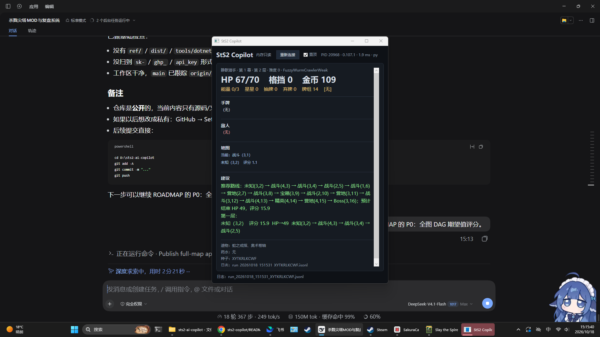
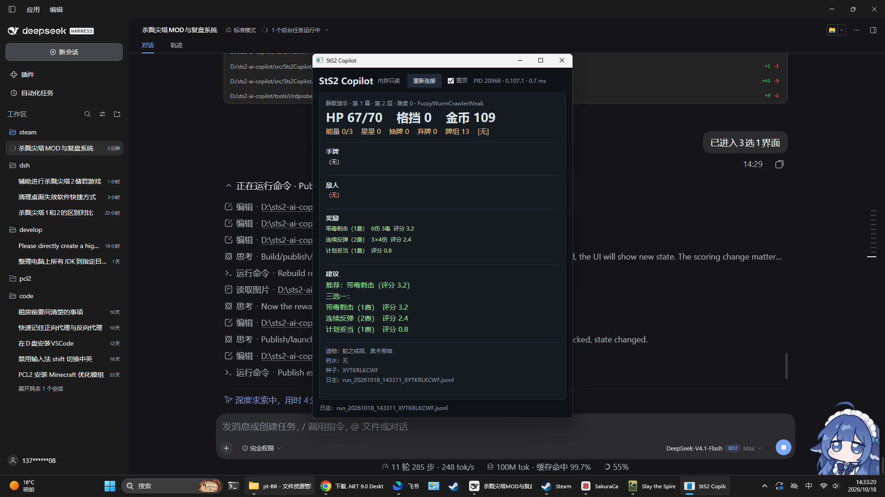

# StS2 Copilot（外部只读版）

杀戮尖塔 2 的外部辅助程序。**不装 mod、不注入、不写内存、不改存档**，通过 ClrMD 只读游戏进程，因此不会影响成就。

> 当前仅支持游戏版本 **0.107.1**。版本不匹配会明确报错并拒绝连接，避免静默读错。





## 运行

1. 先启动 Slay the Spire 2（窗口化或全屏均可）
2. 启动 Python 规则服务（可选，但推荐）：
   - 双击 `start-rules.cmd`
   - 或 `python py\rules\server.py`
   - 状态栏出现 `py` 表示走 Python；`local` 表示回退到 C# 内置规则
3. 运行 `dist\Sts2Copilot\Sts2Copilot.exe`
4. 程序会自动找 `SlayTheSpire2` 进程并连接；失败时点「重新连接」
5. 窗口默认置顶，可以拖动/缩放；关掉「置顶」就不会挡游戏

自包含发布，不需要安装 .NET 运行时。

## 当前功能

- **战斗**：HP/格挡/能量/星星/抽牌/弃牌/牌组、手牌（名称/费用/伤害/格挡/毒）、敌人 HP/格挡/意图
- **意图伤害**：按 `Hook.ModifyDamage` 还原——基础伤害 + 攻击者力量，再乘攻击者虚弱/玩家易伤，最后乘段数
- **战斗求解**：枚举本回合出牌顺序，按“斩杀 > 存活 > 最少掉血 > 敌方剩余 HP > 留能量”评分；输出每张牌的目标、格挡、敌方剩余 HP、预计掉血
- **未知牌降级**：X 费/能力/抽牌等未建模效果不猜，明确列出并回退旧粗算
- **三选一**：读三张候选，按稀有度/效果/费用/牌组密度/毒协同评分并推荐
- **地图**：读全图节点/边 + Boss，Python 做 HP 状态 DAG DP，输出推荐路线、预计结束 HP、评分
- **中文名**：直接读游戏内存里的 `LocManager` 表
- **JSONL 日志**：`%APPDATA%\Sts2Copilot\runs\run_<时间>_<种子>.jsonl`
- **版本锁 + 状态校验**：HP/能量/手牌/牌堆越界即停止建议，不静默读错

## 架构

```
C# 客户端（只读内存 + 第二窗口 + 日志）
   │  POST http://127.0.0.1:8765/advise
   ▼
Python 规则服务（engine.py / combat.py / server.py）
   │  {"advice": [...], "source": "python"}
   ▼
C# 渲染；Python 不可用时回退本地 Advisor（状态栏 local）
```

详见 [docs/ARCHITECTURE.md](docs/ARCHITECTURE.md)。

## 日志

| type | 内容 |
|---|---|
| `run_start` | 种子、角色、难度、初始状态 |
| `combat_start` | 楼层、房间、遭遇 |
| `turn` | 进入出牌阶段时的完整状态 + 建议 |
| `action` | 手牌差集推断的出牌 + 能量/手牌/药水变化 |
| `state_change` | 同一回合内的其他状态变化 |
| `reward` | 三选一候选、评分、推荐 |
| `combat_end` | 战斗结束 HP |
| `run_end` | 退出/关程序/重连 |

`action.played` 是**推断值**：两次轮询之间手牌减少的牌；抽牌与出牌同时发生时可能漏记，但 `energy_before/after` 和 `hand_before/after` 可交叉验证。

## 代码结构

```
src/Sts2Copilot.App/
  MemoryState.cs    ClrMD 读取 + 本地化 + 版本锁/校验 + 地图/奖励
  Advisor.cs        C# 内置规则（Python 不可用时的回退）
  AdvisorClient.cs  POST /advise 到本地 Python 服务
  RunLogWriter.cs   JSONL 落盘
  MainWindow.xaml*  第二窗口 UI
py/rules/
  engine.py         规则/数学核心（战斗、奖励、地图）
  combat.py         本回合出牌 DFS/记忆化求解器
  server.py         127.0.0.1:8765 HTTP 服务
py/tests/           Python 单元测试（无游戏也能跑）
tools/clrdprobe/    调试探针（run / rewards / map / fields）
tools/decomp/       游戏更新后重新反编译
docs/               架构、schema、规则、路线图、ADR
prompts/            DeepSeek 复盘 / 规则 patch 提示词
```

## 开发 / AI 文档

- [.agent.md](.agent.md) — 代理开发指南（先读这个）
- [docs/ARCHITECTURE.md](docs/ARCHITECTURE.md) — 组件与数据流
- [docs/STATE_SCHEMA.md](docs/STATE_SCHEMA.md) — GameState 字段
- [docs/RULES.md](docs/RULES.md) — ruleId、公式、限制
- [docs/ROADMAP.md](docs/ROADMAP.md) — 里程碑
- [docs/VERSIONING.md](docs/VERSIONING.md) — 版本锁与升级流程
- [docs/decisions/0001-external-memory-reading.md](docs/decisions/0001-external-memory-reading.md) — 为什么不做 mod/截图

## 已知限制

- 商店、事件、营地、宝箱还没做
- 特殊意图（非 `DamageCalc` 闭包）可能显示 0 伤害
- 出牌是推断，不是精确事件；后续改读 `CombatManager.History`
- 卡牌描述、遗物计数器、能力层数还没显示
- 求解器只覆盖攻击/格挡/毒/弱/易伤/力量/敏捷；X 费、能力、抽牌、随机目标会降级
- 求解器未计遗物、药水、抽牌顺序、敌人本回合的 buff/debuff 和 Artifact/Intangible 等特殊能力
- 地图掉血是期望值，不是按当前牌组模拟战斗
- 卡牌协同只到“攻击/格挡密度 + 毒”，没有 tag/关键词

## 下一步

1. P1.5 实机校准：预测掉血 vs 实际，补遗物/药水/抽牌/敌人 buff
2. 记录 `reward_pick` / `map_pick`
3. 局末 DeepSeek 复盘 + 规则 patch 审核
4. 商店/事件/营地界面
5. 读 `CombatManager.History` 做精确出牌记录
